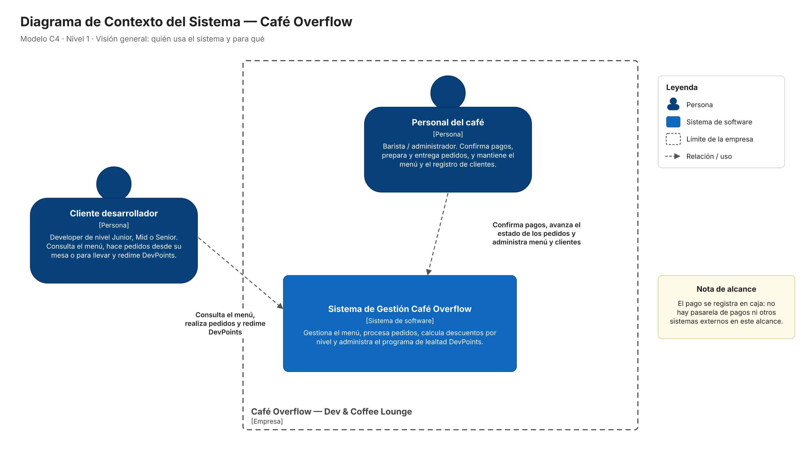
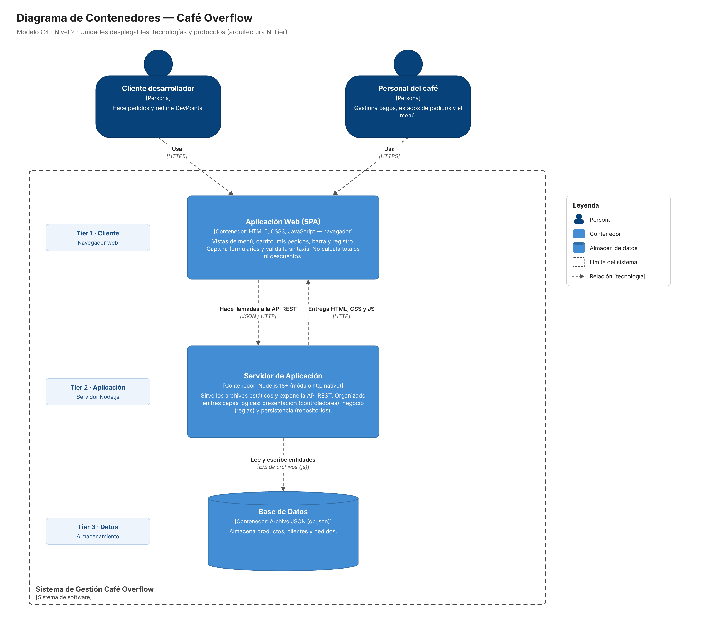
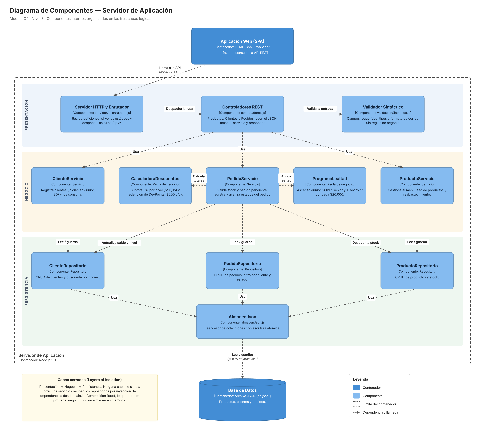

# Café Overflow — Dev & Coffee Lounge

**Taller Modelo N-Tier** · Arquitectura de Software · Universidad Autónoma de Bucaramanga (UNAB)
**Docente:** MSc. Feisar Moreno

**Integrantes:**

| Nombre | GitHub |
|---|---|
| Juan Camilo Calderón | [@CamiloCalder0n](https://github.com/CamiloCalder0n) |
| Santiago Ruiz | |

---

## 1. Descripción

Café Overflow es un café temático para desarrolladores. Los clientes hacen pedidos desde su mesa o para llevar, reciben un **descuento según su nivel** (Junior, Mid, Senior), suben de nivel automáticamente según lo que han comprado y acumulan **DevPoints** que pueden redimir en compras siguientes. El personal de barra gestiona el estado de cada pedido hasta entregarlo.

La aplicación está organizada en **tres capas cerradas** (Presentación → Negocio → Persistencia), cada una en su propia carpeta, y está desarrollada **directamente sobre los lenguajes de cada capa, sin frameworks**.

| Capa | Carpeta | Lenguaje / tecnología |
|---|---|---|
| Presentación (cliente) | `presentation/public/` | HTML5, CSS3 y JavaScript puro en el navegador |
| Presentación (servidor) | `presentation/` | JavaScript (Node.js ≥ 18) con el módulo nativo `http` |
| Negocio | `negocio/` | JavaScript (Node.js) puro: clases y funciones, sin dependencias |
| Persistencia | `persistencia/` | JavaScript (Node.js) con el módulo nativo `fs` sobre un archivo JSON |
| Pruebas | `tests/` | Runner nativo `node:test` + `node:assert/strict` |

> **No hay dependencias de npm.** `package.json` no tiene `dependencies` ni `devDependencies`: no se usa Express, React, Jest ni ningún otro framework o librería. No hace falta ejecutar `npm install`.

---

## 2. Cómo ejecutar

Requisito: **Node.js 18 o superior**.

```bash
# Levantar la aplicación (http://localhost:3000)
npm start

# Otro puerto o archivo de datos
PORT=8080 DB_PATH=/tmp/cafe.json npm start

# Ejecutar las 22 pruebas (17 de negocio + 5 de arquitectura)
npm test
```

**Reiniciar los datos:** la primera vez que arranca, la aplicación crea `persistencia/data/db.json` a partir de `persistencia/data/semilla.js`. Para volver a los datos iniciales, detén el servidor, borra ese archivo y vuelve a ejecutar `npm start`:

```bash
rm persistencia/data/db.json
npm start
```

---

## 3. Estructura de carpetas

```
cafe-overflow/
├── main.js                               Composition Root: único archivo que conoce las 3 capas y las conecta
├── package.json                          Scripts start/test; sin dependencias
├── README.md                             Este documento
├── .gitignore                            Excluye node_modules y la base de datos generada
├── presentation/                         CAPA DE PRESENTACIÓN
│   ├── servidor.js                       Servidor http nativo: rutas /api/* y archivos estáticos (con protección de path traversal)
│   ├── http/
│   │   ├── enrutador.js                  Enrutador hecho a mano (get/post/patch, parámetros :id)
│   │   ├── utilidadesHttp.js             Lectura de JSON, respuestas JSON y mapeo de errores → códigos HTTP
│   │   └── validacionSintactica.js       Validación sintáctica: requeridos, tipos, longitud, formato de correo
│   ├── controladores/
│   │   └── controladores.js              Controladores: leer cuerpo → validar sintaxis → llamar al servicio → responder
│   └── public/
│       ├── index.html                    Estructura de la interfaz de una sola página
│       ├── styles.css                    Tema oscuro "developer", responsive
│       └── app.js                        Lógica de la vista: pinta datos y consume la API (no calcula totales)
├── negocio/                              CAPA DE NEGOCIO
│   ├── constantes.js                     Niveles, % de descuento, umbrales, valor de DevPoints, estados
│   ├── errores.js                        ErrorNegocio, ErrorNoEncontrado, ErrorValidacion
│   ├── reglas/
│   │   ├── calculadoraDescuentos.js      Subtotal, descuento por nivel y redención de DevPoints (funciones puras)
│   │   └── programaLealtad.js            Nivel por acumulado, DevPoints ganados, aplicación del pedido completado
│   └── servicios/
│       ├── productoServicio.js           Casos de uso del menú: listar, obtener, crear, reabastecer
│       ├── clienteServicio.js            Casos de uso de clientes: listar, obtener, registrar
│       └── pedidoServicio.js             Cotizar, registrar, avanzar estado, obtener y listar pedidos
├── persistencia/                         CAPA DE PERSISTENCIA
│   ├── almacenes/
│   │   ├── almacenJson.js                Almacén sobre archivo JSON (fs síncrono, escritura atómica)
│   │   └── almacenMemoria.js             Almacén en memoria con la misma interfaz (para las pruebas)
│   ├── repositorios/
│   │   ├── repositorioBase.js            listar, buscarPorId, buscarPor, crear, actualizar
│   │   └── repositorios.js               ProductoRepositorio, ClienteRepositorio, PedidoRepositorio
│   └── data/
│       └── semilla.js                    Datos iniciales (12 productos, 3 clientes, 0 pedidos)
├── tests/
│   ├── negocio.test.js                   17 pruebas de las reglas de negocio
│   └── arquitectura.test.js              5 fitness functions que verifican las dependencias entre capas
└── docs/
    └── diagramas/                        Diagramas C4 (niveles 1, 2 y 3)
```

---

## 4. Flujo entre capas

```
 Navegador (index.html + app.js)
      │  fetch → /api/...  (JSON)
      ▼
 ┌──────────────────────────── PRESENTACIÓN ───────────────────────────┐
 │ servidor.js → enrutador.js → controladores.js                       │
 │                 validacionSintactica.js · utilidadesHttp.js          │
 └──────────────────────────────────┬──────────────────────────────────┘
      │  llamada a métodos de servicio (objetos JS)
      ▼
 ┌────────────────────────────── NEGOCIO ──────────────────────────────┐
 │ productoServicio · clienteServicio · pedidoServicio                  │
 │ calculadoraDescuentos · programaLealtad · constantes · errores       │
 └──────────────────────────────────┬──────────────────────────────────┘
      │  repositorios inyectados por constructor (listar, crear, ...)
      ▼
 ┌──────────────────────────── PERSISTENCIA ───────────────────────────┐
 │ repositorios.js → repositorioBase.js → almacenJson.js                │
 └──────────────────────────────────┬──────────────────────────────────┘
      │  fs.readFileSync / writeFileSync + renameSync
      ▼
 persistencia/data/db.json
```

`main.js` (Composition Root) crea el almacén y los repositorios, se los inyecta a los servicios y entrega los servicios al servidor. Ninguna capa crea objetos de otra capa ni se salta una capa.

---

## 5. Cumplimiento de las restricciones arquitectónicas

| Capa | Restricción | Cómo se cumple |
|---|---|---|
| Presentación | Solo renderiza vistas, captura formularios y hace validación **sintáctica** | `validacionSintactica.js` revisa requeridos, tipos, longitud (≤ 120) y formato de correo; las reglas quedan en negocio |
| Presentación | **No** calcula totales, % de descuento ni ascensos | `app.js` llama a `POST /api/pedidos/cotizar` (con *debounce* de 200 ms) en cada cambio del carrito y solo muestra lo que devuelve el servidor, incluido el máximo de DevPoints redimibles |
| Presentación | **No** consulta la base de datos | Solo importa `negocio/errores.js` y sus propios archivos; recibe los servicios ya construidos. Lo verifica `arquitectura.test.js` |
| Negocio | Calcula descuentos, ascensos, verifica stock y gestiona el estado | `calculadoraDescuentos.js`, `programaLealtad.js` y `pedidoServicio.js` |
| Negocio | **No** contiene HTML/JSON ni conoce tecnologías de UI | No importa `http`, `fs`, `path` ni `url`; no usa `JSON.parse/stringify` ni etiquetas HTML. Lo verifica `arquitectura.test.js` |
| Negocio | **No** ejecuta consultas directas a datos | Recibe `productoRepositorio`, `clienteRepositorio` y `pedidoRepositorio` por **inyección de dependencias** en el constructor; nunca los crea |
| Persistencia | Solo consulta, guarda y actualiza entidades | Repositorios genéricos (`listar`, `buscarPorId`, `crear`, `actualizar`) y consultas por campo |
| Persistencia | **No** evalúa reglas de negocio | No importa `negocio/` ni `presentation/`. Lo verifica `arquitectura.test.js` |
| Todas | Sin frameworks | Solo módulos nativos de Node.js y JavaScript del navegador; `package.json` sin dependencias |

---

## 6. Reglas de negocio

| Regla | Archivo | Detalle |
|---|---|---|
| 1. Descuento por nivel | `negocio/reglas/calculadoraDescuentos.js` | Sobre el subtotal: Junior 5 %, Mid 10 %, Senior 15 % (`Math.round`) |
| 2. Ascenso automático | `negocio/reglas/programaLealtad.js` | Cliente nuevo: Junior, $0, 0 DevPoints. Acumulado ≥ $500.000 → Mid; ≥ $1.500.000 → Senior. El nuevo nivel aplica a las compras siguientes |
| 3a. DevPoints ganados | `negocio/reglas/programaLealtad.js` | 1 DevPoint por cada $20.000 del total pagado (`Math.floor`), al entregar el pedido |
| 3b. Redención de DevPoints | `negocio/reglas/calculadoraDescuentos.js` | Cada DevPoint vale $200 de descuento directo |
| 4a. Stock suficiente | `negocio/servicios/pedidoServicio.js` | Se rechaza el pedido si la cantidad de un producto supera su stock |
| 4b. Un pedido pendiente a la vez | `negocio/servicios/pedidoServicio.js` | Se rechaza si el cliente ya tiene un pedido en `Pendiente de pago` |
| Estados del pedido | `negocio/constantes.js`, `pedidoServicio.js` | `Pendiente de pago` → `En Preparación` → `Listo` → `Entregado` |

---

## 7. Decisiones de interpretación

1. **Pedido completado = estado `Entregado`.** Solo al entregar se suma el total al acumulado, se otorgan DevPoints y se evalúa el ascenso.
2. **Orden de cálculo:** `subtotal` → `descuentoNivel = Math.round(subtotal × %)` → `totalTrasNivel = subtotal − descuentoNivel` → `descuentoDevPoints = puntos × 200` → `total = totalTrasNivel − descuentoDevPoints`.
3. **"Consumido" = `total` pagado** (después de descuentos). Con ese valor se calculan los DevPoints ganados y el acumulado.
4. **Redención:** los DevPoints redimidos salen del saldo **al registrar** el pedido. Es un error pedir más de los que se tienen. Máximo redimible = `min(saldo, floor(totalTrasNivel / 200))`, así el total nunca queda negativo. Debe ser un entero ≥ 0.
5. **El stock se descuenta al registrar** el pedido (queda reservado).
6. **Ítems repetidos** del mismo producto se suman antes de validar el stock.
7. **Transiciones:** solo al estado siguiente. Si se envía un estado distinto al siguiente → error "Transición no permitida". Un pedido `Entregado` no cambia. Pasar de `Pendiente de pago` a `En Preparación` equivale a confirmar el pago en caja.
8. **Correo único** por cliente (comparación sin distinguir mayúsculas). Se guarda en minúsculas.
9. **Producto:** `precioBase` entero > 0, `stock` entero ≥ 0 y nombre único.

---

## 8. API REST

| Método | Ruta | Acción | Éxito |
|---|---|---|---|
| GET | `/api/productos` | Listar el menú | 200 |
| POST | `/api/productos` | Crear `{ nombre, precioBase, stock }` | 201 |
| PATCH | `/api/productos/:id/stock` | Reabastecer `{ unidades }` | 200 |
| GET | `/api/clientes` | Listar clientes | 200 |
| GET | `/api/clientes/:id` | Obtener un cliente | 200 |
| POST | `/api/clientes` | Registrar `{ nombre, correo }` | 201 |
| GET | `/api/pedidos?clienteId=&estado=` | Listar pedidos (más recientes primero) | 200 |
| POST | `/api/pedidos/cotizar` | Cotizar `{ clienteId, items: [{ productoId, cantidad }], devPointsARedimir }` sin guardar | 200 |
| GET | `/api/pedidos/:id` | Obtener un pedido | 200 |
| POST | `/api/pedidos` | Registrar el pedido (mismo cuerpo que cotizar) | 201 |
| PATCH | `/api/pedidos/:id/estado` | Avanzar al estado siguiente `{ estado? }` → `{ pedido, lealtad }` | 200 |

**Códigos de error:**

| Código | Cuándo | Cuerpo |
|---|---|---|
| **400** | Datos mal formados: JSON inválido, campos faltantes, tipos incorrectos, correo con formato inválido (`ErrorSolicitud`, capa de presentación) | `{ error, detalles: [...] }` |
| **404** | Recurso inexistente (`ErrorNoEncontrado`) o ruta desconocida | `{ error }` |
| **409** | Conflicto con una regla de negocio: correo o nombre de producto duplicado, transición de estado no permitida (`ErrorNegocio`) | `{ error }` |
| **422** | Violación de una regla de negocio: stock insuficiente, pedido pendiente de pago, DevPoints inválidos (`ErrorValidacion`) | `{ error }` |
| 500 | Error inesperado (se registra con `console.error`) | `{ error }` |

---

## 9. Diagramas C4

### Nivel 1 — Contexto



### Nivel 2 — Contenedores



> **Nota:** el archivo JSON de persistencia vive en la misma máquina que el servidor Node.js. Como la capa de negocio solo conoce la interfaz de los repositorios (inyectados desde `main.js`), el almacén se puede cambiar por PostgreSQL o MongoDB escribiendo nuevos repositorios en `persistencia/`, **sin tocar la capa de negocio**.

### Nivel 3 — Componentes



---

## 10. Declaración de uso de IA

_Completar por el equipo._

| Herramienta | Versión del modelo | Momento de uso | Prompts principales | Aportes propios del equipo |
|---|---|---|---|---|
| | | | | |
| | | | | |
